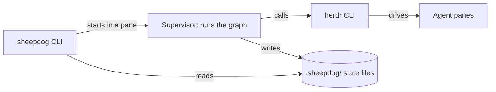

# Sheepdog spec

Shea Hawkins · November 9, 2026

## Summary

Sheepdog is a single static binary that runs graphs of coding agents inside [herdr](https://herdr.dev/docs/), once or on a recurring loop. Its CLI mirrors [OpenEngine's `oe`](https://github.com/OpenEngine/OpenEngine), without the daemon, database or web UI.

Graphs are written in TypeScript: small script files modelled on Claude's workflow scripts, where a review cycle is an ordinary `for` loop.

| Decision | Choice |
| --- | --- |
| Distribution | One static Go binary for macOS, Linux and Windows; the only runtime dependency is `herdr` on the PATH |
| Runtime | No daemon. Each run or loop is a supervisor process in a herdr pane |
| State | Plain JSON and JSONL files under `.sheepdog/` |
| herdr link | Shell out to the `herdr` CLI and parse its JSON |
| Graph language | TypeScript files, cycles allowed |
| v1 CLI | Graphs, runs, loops and node steering |
| v2 | Lightweight budgets and forge |

## Goals and non-goals

V1 does one job: run a graph of herdr agents to completion, once or on a schedule, and let a person watch and steer it.

Goals:

- One binary, copied onto a machine that has herdr, is the whole install.
- Commands and flags match `oe` wherever the feature exists, so habits transfer.
- Graphs can contain cycles, such as security findings going to a validator and back to the implementer.
- A run survives a crash or a herdr restart and resumes at the first unfinished step.
- Every piece of state is a readable file.

Not in v1:

- A daemon, HTTP API or web UI.
- Backends, an agent registry, the `go` verbs and approval policies.
- Budgets and forge integration, which move to v2.
- Reading OpenEngine's `graph.yaml` files.
- npm packages or Node APIs inside graph files.

## Architecture

Sheepdog is one Go binary that plays two roles: the CLI you type, and a supervisor process that runs a graph inside a herdr pane. There is no daemon; herdr's server is what keeps supervisors alive.



The CLI starts a supervisor and otherwise only reads state files. The supervisor is the only writer for its run.

Three things are compiled into the binary:

- **esbuild**, which strips TypeScript types and bundles relative imports.
- **goja**, a pure-Go JavaScript interpreter that executes the result.
- **A herdr adapter**, one small interface implemented by spawning `herdr` and parsing its JSON. A socket implementation can replace it later without touching anything else.

State is plain files, written by temp-file-and-rename so a crash never leaves a half-written record:

```
.sheepdog/
  graphs/<name>/<n>.ts              registered graph versions
  runs/<run-id>/run.json            status, graph version, inputs, herdr tab
  runs/<run-id>/journal.jsonl       one line per completed agent() call
  runs/<run-id>/events.jsonl        what `run watch` tails
  runs/<run-id>/nodes/<exec-id>/    prompt, result file, captured output
  loops/<name>.json                 local loop state: on or paused, last run
```

The directory lives in the project root by default, so graphs travel with the repository.

Run history stays local. The first command that creates `.sheepdog/` also writes `.sheepdog/.gitignore` containing `runs/`, so prompts, agent output and journals are never committed by accident. Graphs are meant to be committed.

`loops/` is ignored the same way, because it holds state, not definitions. A graph's `meta.loop` declares the schedule. The file under `loops/` only records that the loop is switched on in this checkout, which graph version it pinned, whether it is paused and when it last ran. A restarted loop supervisor needs that record to avoid running twice.

## Concepts

Sheepdog keeps OpenEngine's four nouns and maps each onto something herdr already provides.

| Concept | Meaning | In herdr |
| --- | --- | --- |
| Graph | A registered TypeScript file. Re-adding a changed file creates a new version; an identical file is a no-op | Nothing until it runs |
| Run | One execution of one pinned graph version | One tab, with the supervisor in its root pane |
| Node | One labelled agent in a run. The same label always means the same agent | One pane, started with `herdr agent start <run>-<label> --kind <kind>` |
| Node execution | One `agent()` call: a prompt sent to a node and its result | `herdr agent prompt … --wait`, then the result file or `herdr agent read` |
| Loop | Recurring runs of one pinned version; runs never overlap | A supervisor pane that sleeps for `--every` and starts the next run |

A node can have many executions. That is how a cycle works: the second prompt to `implement` goes to the pane that wrote the code, with its context intact.

## Graph language

A graph is a TypeScript file with a literal `meta` block followed by ordinary code that calls `agent()`. Control flow is the language's own: a cycle is a bounded `for` loop, a branch is an `if`.

```typescript
export const meta = {
  name: 'secure-implement',
  description: 'Implement, security review, validate findings, fix',
  loop: { every: '6h', instruction: 'Pick up the next open ticket.' },
}

type Finding = { id: string; title: string }
type Verdict = { id: string; isReal: boolean; reason: string }

await agent(`Implement: ${args.instruction}`, {
  label: 'implement', kind: 'claude',
})

for (let round = 0; round < 3; round++) {
  const review = await agent<{ findings: Finding[] }>('Security review the diff.', {
    label: 'security', kind: 'codex', schema: FINDINGS,
  })

  const verdicts = await parallel(review.findings.map(f => () =>
    agent<Verdict>(`Try to disprove: ${f.title}`, {
      label: `validate-${f.id}`, kind: 'claude', schema: VERDICT,
    })))

  const confirmed = verdicts.filter(v => v.isReal)
  if (confirmed.length === 0) break

  await agent(`Fix these confirmed findings: ${JSON.stringify(confirmed)}`, {
    label: 'implement',
  })
}
```

The API is six names:

| Name | What it does |
| --- | --- |
| `meta` | Literal object: `name`, `description`, and optional `inputs`, `loop` defaults and `maxCalls` |
| `args` | `instruction` plus any `-i KEY=VALUE` inputs |
| `agent(prompt, opts)` | Sends a prompt to the node named by `label` and returns its result. Options: `label`, `kind`, `schema`, `timeout` |
| `parallel(thunks)` | Runs several `agent()` or `graph()` calls at once and returns their results in order |
| `graph(name, args)` | Runs another registered graph as a step of this one and returns the value it returns |
| `log(message)` | Writes a line to the run's event log |

Rules:

- **Imports and `meta` come first.** A graph starts with its imports and `export const meta`, and `meta` is its only export. The rest of the file becomes the body of an async function, which is what allows top-level `await` and `return`.
- **TypeScript the language, not Node.** There are no npm packages and no Node APIs. Relative imports between your own files are bundled at `graph add`.
- **Types are stripped, not checked.** `sheepdog graph types` writes a `sheepdog.d.ts` so the editor and `tsc` do the checking.
- **Scripts are deterministic.** The clock and random numbers are unavailable, because resume works by replaying the script.
- **Runs are capped.** A run stops after `maxCalls` executions, 50 by default, so a cycle cannot run away.
- **`kind` is a herdr agent kind**, such as `claude`, `codex` or `opencode`. It is required the first time a label appears and optional after.

### Calling one graph from another

`graph()` runs a registered graph inline, inside the calling run: same supervisor, same herdr tab, same journal.

```ts
const review = await graph('security-review', { instruction: 'Review the current diff.' })
if (review.confirmed.length > 0) {
  await agent(`Fix these: ${JSON.stringify(review.confirmed)}`, { label: 'implement' })
}
```

- **A graph's result is what its script returns.** A top-level `return` ends the script and hands the value to the caller, or to `run get` for a top-level run.
- **Labels are namespaced.** The child's `security` node becomes `security-review/security`, so its agents never collide with the caller's.
- **Versions are pinned at run start.** The run records which version of each child graph it resolved, so resume replays against the same code.
- **Limits are shared.** Child calls count toward the caller's `maxCalls`, and nesting stops at 8 levels, which also catches a graph that calls itself.
- **A child's `meta.loop` is ignored.** Only the graph a loop was added for runs on a schedule.

## CLI

The v1 surface is `oe`'s graph, run, loop and node commands under the name `sheepdog`. List commands print tables, or JSON with `--json`.

```
sheepdog graph add ./secure-implement.ts
sheepdog graphs list
sheepdog graph get NAME[@N]
sheepdog graph run NAME "instruction" [-i KEY=VALUE] [--wait] [--no-watch] [--json]
sheepdog graph types

sheepdog runs [--graph NAME] [--loop NAME] [--status STATUS] [--limit N]
sheepdog run get RUN_ID
sheepdog run watch RUN_ID
sheepdog run resume RUN_ID
sheepdog run stop RUN_ID

sheepdog loop add NAME --every 6h [--instruction TEXT] [--no-run-now]
sheepdog loops list
sheepdog loop pause NAME [--reason TEXT]
sheepdog loop resume NAME

sheepdog nodes list --run RUN_ID
sheepdog node get EXECUTION_ID
sheepdog node steer EXECUTION_ID "message" [--wait]
```

Three commands are not in `oe`: `graph types`, `run resume` and `run stop` exist because there is no daemon to do those jobs, and a run needs a way to restart from its files.

Differences in behaviour:

- `graph run` opens a herdr tab and returns the run ID. `--wait` blocks until the run ends and exits non-zero on failure.
- `run watch` tails the run's event log. Focusing the run's tab in herdr shows the agents themselves.
- `node steer` sends a message to the live agent behind that execution with `herdr agent prompt`. It is refused if the agent is blocked.
- `--every` accepts `m`, `h` and `d` units.
- The global flag `--session NAME` passes through to herdr.

## Run lifecycle

A run is the graph script executing inside a supervisor, with every completed `agent()` call written to a journal before the script moves on.

1. `graph run` writes `run.json`, creates a herdr tab and starts the supervisor in its root pane.
2. The supervisor strips the types, loads the script and runs it.
3. On an `agent()` call for a new label, it splits a pane and starts the agent. For a known label it reuses the pane.
4. It sends the prompt, waits for the agent to finish, and collects the result.
5. It appends the call and its result to `journal.jsonl`, then returns the result to the script.
6. When the script ends or throws, it marks the run `succeeded` or `failed` and leaves the tab open for inspection.

**Results come from files, not the screen.** Each prompt ends with an instruction to write the result to a named file in the run directory. With a `schema`, a JSON Schema object, the file must be JSON that validates; the supervisor asks again up to twice before failing the call. Without one, the file's text is the result, and `herdr agent read` is the fallback if no file appears.

**Blocked agents stop the call, not the run.** If herdr reports an agent as blocked on an approval or question, the run shows `blocked`, a herdr notification fires, and the supervisor waits. It never answers on the agent's behalf.

**Resume is replay.** `run resume` starts a new supervisor that re-runs the script from the top. Calls already in the journal return their recorded results at once, so execution picks up at the first unfinished call. A journal entry is matched on label, prompt and position; a mismatch fails the resume instead of guessing.

**Delivery is checked before any retry.** A timeout from herdr does not prove a prompt was not delivered, so the supervisor reads the pane before sending anything twice.

Run statuses are `running`, `blocked`, `succeeded`, `failed` and `stopped`.

## v2: budgets and forge

V2 adds loop limits and pull requests by shelling out to `gh`, with no OAuth flow, webhooks or stored tokens.

| Feature | Lightweight version |
| --- | --- |
| `--max-runs N` | The loop stops after N runs. Needs no forge at all |
| `--max-prs N` | The loop pauses when N pull requests opened by its runs are still open, counted with `gh pr list` on a branch prefix |
| `--max-spend USD` | Only if agents report session cost somewhere readable. Subscription usage would count as unpriced, as in OpenEngine |
| Opening a PR | A `pr()` function in the graph language that pushes the branch and runs `gh pr create` |
| Isolation | Each run gets its own checkout through `herdr worktree create` |

Also deferred to v2 or later: the `go`, `review` and `fix` verbs, named agent profiles, and running on another machine through herdr's `--machine` flag.

## Risks and first spikes

The design rests on five things that are not yet proven, and each has a small spike that settles it.

| Risk | Why it matters | Mitigation |
| --- | --- | --- |
| Agents may not write the result file reliably | Every branch in a graph depends on structured results | Retry with the validation error; fall back to reading the pane for plain text |
| herdr waits do not track individual turns | A wait can return on an earlier turn's completion, or time out after delivery | Confirm the agent went `working` after each prompt; read the pane before retrying |
| Supervisors die when herdr's server stops | Loops and runs stop silently | Journal and replay; `loops list` flags a loop whose supervisor is gone |
| The embedded interpreter may not handle `async` and `await` well | The graph language depends on it | Settled by spike 1: goja's promises work, and `parallel()` runs calls concurrently |
| Parts of herdr's interface are unconfirmed | Event and socket docs were incomplete when read, and ID stability across restarts is undocumented | Check against `herdr api schema --json`; store agent names, not pane IDs |

Spikes, in order:

- [x] Run a TypeScript file through embedded esbuild and goja, with `await` and a blocking Go function behind `agent()`. See [the findings](docs/spikes/01-esbuild-goja.md).
- [ ] Drive one agent end to end with the herdr CLI: start, prompt, wait, result file.
- [ ] Kill a supervisor mid-run and resume it from the journal.
- [ ] Confirm the binary cross-compiles and runs on macOS, Linux and Windows.

## Sources

- [OpenEngine repository](https://github.com/OpenEngine/OpenEngine) and its [CLI README](https://raw.githubusercontent.com/OpenEngine/OpenEngine/HEAD/cli/README.md)
- herdr [CLI reference](https://herdr.dev/tui/docs/cli-reference/), [agent automation](https://herdr.dev/tui/docs/agent-automation/) and [socket API](https://herdr.dev/tui/docs/socket-api/)
